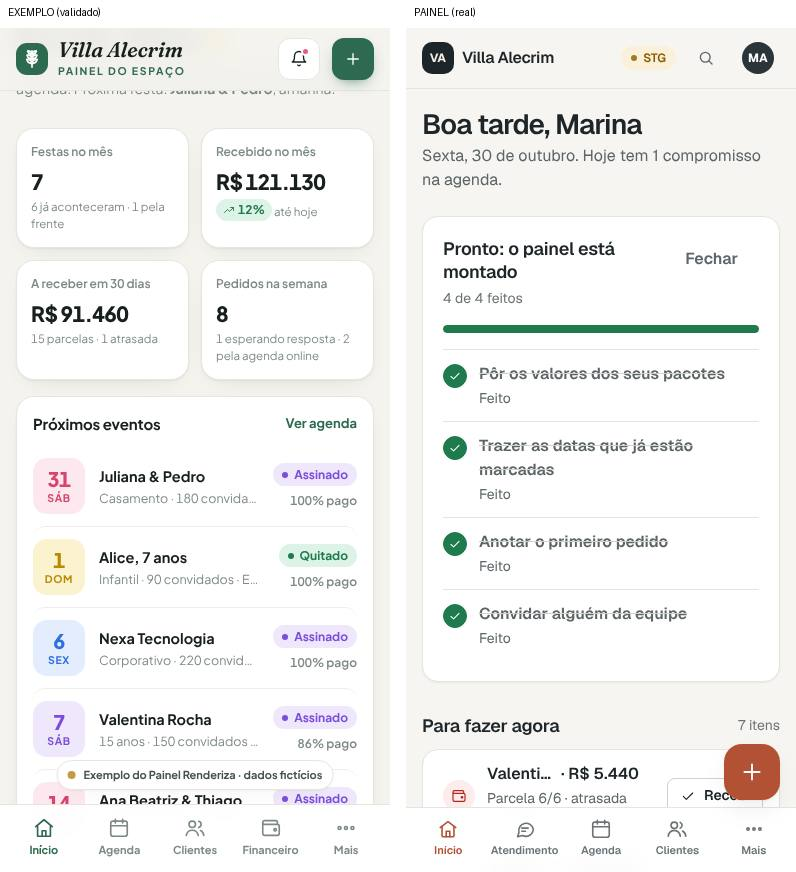
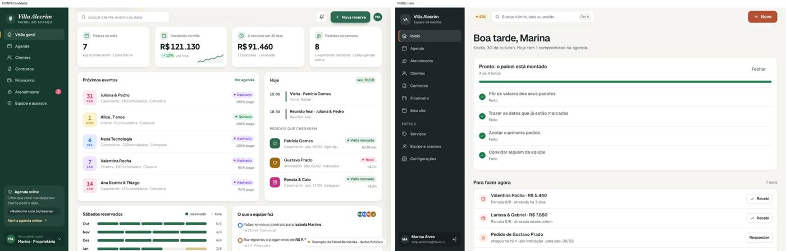
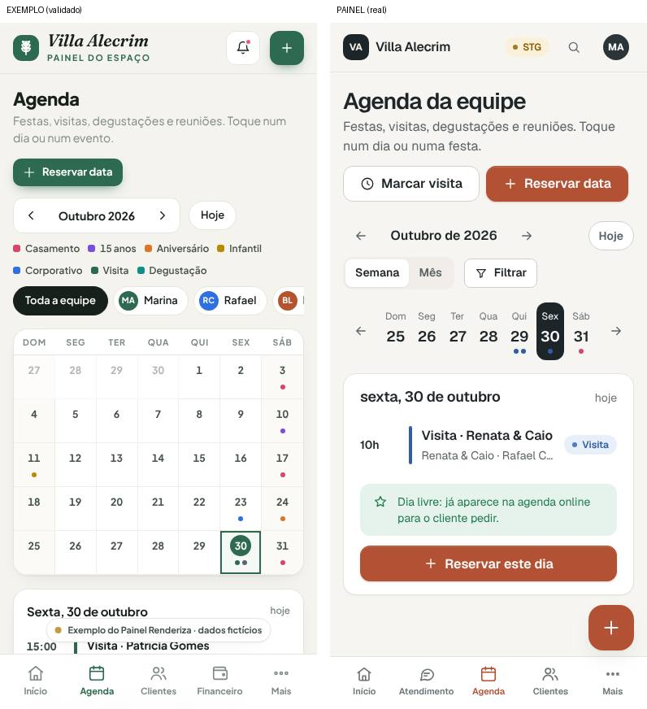
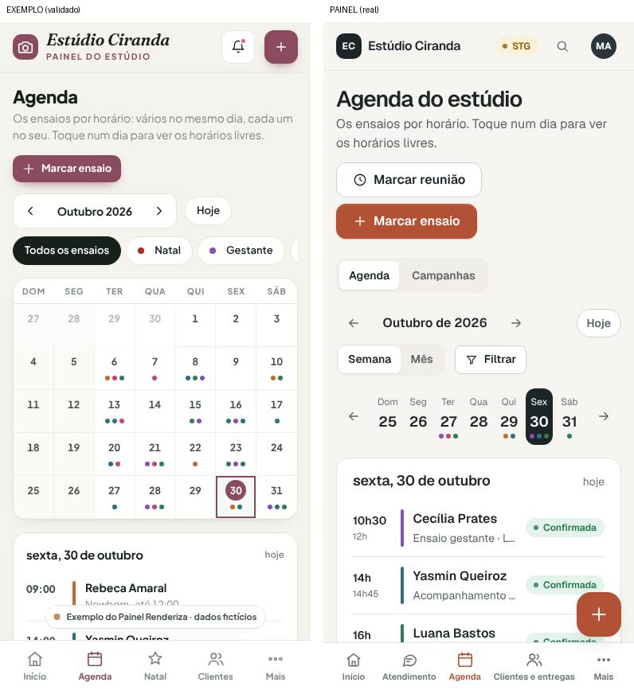

# A cara dos exemplos (Missão 7, bloco A)

A Renderiza validou a experiência de `exemplos/painel-eventos.html` e `exemplos/painel-fotografia.html`, no celular e
no computador (D50). Esta é a lista de diferenças entre eles e o painel real, tela a tela, com os mesmos dados
fictícios (Villa Alecrim e Estúdio Ciranda), comparados lado a lado em 30/10/2026. Para cada uma: o que o exemplo faz,
o que o painel faz hoje, a proposta e a recomendação.

**Legenda:** ✅ feito · 🟢 recomendo fazer · 🟡 a Renderiza decide (o painel seguiu uma decisão do `09` que diverge do
exemplo) · ⚪ depois (precisa de função nova)

## Em todas as telas (a casca)

| # | Exemplo | Painel hoje | Proposta | |
|---|---|---|---|---|
| G1 | a **cor do negócio** em tudo: botões, aba ativa, "+", o dia de hoje, a barra do computador (o verde da Villa, o vinho do estúdio) | a terracota da Renderiza em tudo, em toda conta | o tema do nicho na casca (as cores que o onboarding já usa, D33) | ✅ |
| G2 | no topo, o nome do negócio com "Painel do espaço" ou "Painel do estúdio" embaixo, e o logo | as iniciais e o nome | o nome com a linha de baixo, e o logo quando a conta tem | ✅ |
| G3 | no celular, o **"+" no topo**, ao lado do nome | o "+" flutuante embaixo, à direita, que cobre botões da lista ("Recebi", um chip) | o "+" no topo, no celular | ✅ |
| G4 | o sino de avisos no topo | a busca no topo | depois: os avisos (pedido novo, parcela vencendo) | ⚪ |
| G5 | abas de baixo, eventos: Início, Agenda, Clientes, Financeiro, Mais (fotografia: Início, Agenda, Natal, Clientes, Mais) | Início, Atendimento, Agenda, Clientes, Mais | o `09` pôs o Atendimento em segundo ("Barra de baixo"). Manter ou voltar ao exemplo? | 🟡 |
| G6 | no computador, a barra lateral na cor do negócio, com o cartão "Agenda online" (o link para mandar) | a barra lateral grafite | a barra na cor escura do tema (com o G1); o cartão da agenda online depois | ✅ cor · ⚪ cartão |

## Início

| # | Exemplo | Painel hoje | Proposta | |
|---|---|---|---|---|
| I1 | começa pelos 4 números (com a tendência "↗ 12%"), depois "Próximos eventos" e "Hoje" | começa por "Para fazer agora", depois os números | o `09` decidiu "Para fazer agora" primeiro. Manter (recomendo: é o que vende o painel) ou voltar ao exemplo? | 🟡 |
| I2 | sem o cartão dos primeiros passos | o cartão "Pronto: o painel está montado" fica até tocar em "Fechar" | sumir sozinho quando os passos estão todos feitos | ✅ |
| I3 | "Próximos eventos" com a situação do contrato ("Assinado", "Quitado") e o quanto já foi pago ("86% pago") | o nome, o tipo e a data | pôr a etiqueta e o "% pago" (quem tem Financeiro ou Contratos) | ✅ |
| I4 | "Sábados reservados": a ocupação dos próximos meses em barras | não tem | depois: a ocupação por mês | ⚪ |

## Agenda

| # | Exemplo | Painel hoje | Proposta | |
|---|---|---|---|---|
| A1 | no celular, abre no **mês**, com os pontinhos de cada dia e a lista do dia embaixo | no celular, abre na semana (decisão do `09`), com "Mês" num toque | abrir no mês também no celular, como o exemplo | ✅ |
| A2 | a legenda das cores dos tipos e as pessoas da equipe à vista, em chips | um botão "Filtrar" | a legenda à vista; as pessoas no "Filtrar" | ✅ |
| A3 | um botão: "Reservar data" (fotografia: "Marcar ensaio") | dois: "Marcar visita" e "Reservar data" | manter os dois (o "Marcar visita" é uma das 5 tarefas do `09`) | 🟡 |

## Atendimento

| # | Exemplo | Painel hoje | Proposta | |
|---|---|---|---|---|
| T1 | começa pelo funil em números (pedidos em 30 dias, visitaram, receberam orçamento, fecharam) | o funil fica recolhido embaixo ("Como vão os pedidos") | o funil em cima, compacto | ✅ |
| T2 | cada pedido com o ícone da origem, colorido (WhatsApp, Instagram, site, indicação) | as iniciais do nome | o ícone da origem | ✅ |

## Financeiro

| # | Exemplo | Painel hoje | Proposta | |
|---|---|---|---|---|
| F1 | o gráfico "Receita por mês" à vista, logo depois dos números; "Vendas por pacote" | o gráfico e "o que mais vende" recolhidos embaixo | o gráfico à vista (aberto) | ✅ |
| F2 | "Ticket médio" e "Em atraso" (com o nome) nos números | "Falta receber no mês" e "Atrasadas" | trocar "Falta receber no mês" por "Ticket médio" quando o mês já está todo recebido | 🟡 |

## Como foi comparado

As imagens são a primeira tela de cada um, lado a lado (exemplo à esquerda), no celular (390 px) e no computador
(1.440 px). Para repetir: servir a raiz do repositório (`python3 -m http.server`) para os exemplos e o `npm run dev`
para o painel, com um dono temporário na Villa ou no Estúdio Ciranda (como em `test/fluxos/`).
